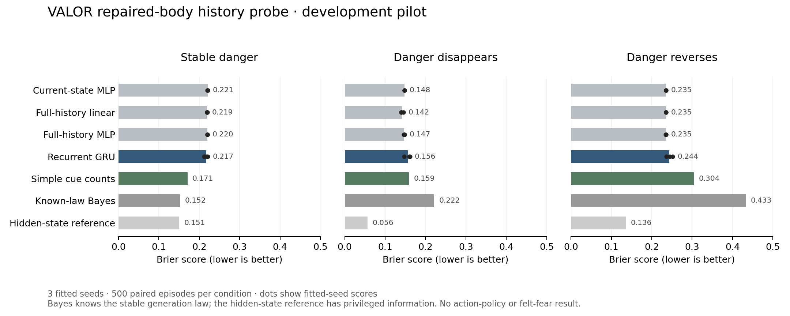

# Build report 08 — learned survival-history prediction

**Date:** October 12, 2026. **Status:** research build in progress; frozen development pilot completed.

## Outcome

VALOR now has a controlled repaired-body history benchmark and a trained compact recurrent damage predictor. It tests whether previous harm can inform anticipation after current body variables have fully recovered. It also includes equally informed history controls, a stateless control, simple cue counts, known-law and privileged references, shifted conditions and shuffled-history ablations.

The important measured result is negative for this recurrent recipe: **simple cue counts outperform the GRU under stable danger**. Across three training seeds, mean Brier scores were **0.21693 for the GRU versus 0.17097 for cue counts**, 26.9% higher error for the GRU under that score. Lower is better. This does not justify replacing a simpler memory mechanism with this model.

All **164 regression tests passed in 32.23 seconds**. Three measured fits took **25.27 seconds total** and stayed below **277.74 MiB sampled process memory**. External spend remains **$0**. Checkpoints, datasets and per-episode predictions are retained locally; source, scientific figures, protocol and curated measurements are versioned in GitHub.

This is predictive development evidence from a constructed task. It is not evidence of subjective fear, improved action selection, autonomous survival or AACE's counterfactual-memory advantage.

## Implementation

- `src/aace/benchmarks/history.py`: seeded public histories, full repair/replenishment intervention, observed damage targets, recovery-cost accounting, separated train/selection/check groups, hashes and input invariants.
- `src/aace/learning/history.py`: recurrent and simpler heads, matched update/checkpoint opportunities, bounded CPU training, restricted weight loading, streaming recurrent state, probability scores, paired episode bootstrap intervals and history ablations.
- `scripts/Run-HistoryPilot.py`: frozen three-seed pilot with an incremental manifest, actual datasets/checkpoints and all nine condition evaluations.
- `scripts/Plot-HistoryPilot.py`: regenerates the scientific figure from saved measurements. PNG and SVG were inspected and are retained in `reports/figures/`.
- CLI commands `collect-history`, `train-history` and `evaluate-history` expose individual stages.

The protocol was committed before training. No check-driven recipe changes or second tuned pilot were made. Existing decision policy and premium UI were not changed by this research work. The preceding UI report and current launch instructions were completed as the first commit of this session.

## What the task tests

An episode randomly assigns one of two visible cues a damage probability of 0.65; the other has probability 0.05. Twelve encounters produce public harm/body observations. An external test harness repairs damage and replenishes resources before each next encounter. Damage costs two recovery units and reduces integrity by 0.25; work costs one resource unit. This intervention deliberately creates identical current body states after different histories. It is not free recovery in the existing mission simulator.

The model receives six features over thirteen rows: cue indicators, observed harm, whether the encounter already happened, integrity and resource fraction. The last row is the current pre-action query: health/resources are 1, harm/exposure-completed are 0. The next damage event is the target. No future outcome, episode seed, latent danger assignment, label or analytic reference probability enters a learned head's inputs.

Training and selection use stable cue danger. Separate development checks include stable danger, danger disappearing in the last four encounters, and danger reversing in the last four encounters. Shift conditions were not used in fitting. This measures untrained shift behavior, not learned extinction or successful adaptation.

## Data and controls

| Group | Episodes | Episode seeds | Query damage events |
|---|---:|---|---:|
| Training, stable | 3,000 | 0–2,999 | 1,096 |
| Selection, stable | 500 | 10,000–10,499 | 171 |
| Check, stable | 500 | 12,000–12,499 | 161 |
| Check, extinction | 500 | Same paired check seeds | 30 |
| Check, reversal | 500 | Same paired check seeds | 189 |

The five groups contain 5,000 episode records. Shift checks share episode seeds and disturbances; they are not 1,500 independent check subjects. Training, selection and check seed groups are disjoint. Reserved final-test episodes remain unused.

| Learned control | Parameters | Information |
|---|---:|---|
| Stateless MLP | 113 | Current query only |
| Full-history linear | 79 | Exact flattened public sequence |
| Full-history MLP | 1,121 | Same sequence, fourteen hidden units |
| Recurrent GRU | 1,169 | Same sequence, sixteen recurrent units |

All learned controls use the same data, minibatch order, 600 updates per model per fit, optimizer rate and selection opportunities. Their output heads start from the training event prior; epoch zero is eligible. Updates are matched; computation is not equalized. The GRU's hidden state alone is 64 bytes of float32 values, excluding weights, framework memory and other buffers. Streaming and full-sequence predictions agree in the regression checks, and resetting state prevents cross-episode carryover.

Cue counts use Laplace-smoothed damage/exposure counts for the query cue without training. The Bayes reference knows the stable generation law but uses public history only. The hidden-state reference has privileged latent information and is not an equally informed competitor.

## Results

Mean Brier score across fitted seeds 42, 43, 44; lower is better. Non-learned references have identical scores across fits.

| Predictor | Stable | Danger disappears | Danger reverses |
|---|---:|---:|---:|
| Stateless MLP | 0.22062 | 0.14800 | 0.23538 |
| Full-history linear | 0.21936 | 0.14178 | 0.23543 |
| Full-history MLP | 0.22005 | 0.14727 | 0.23508 |
| Recurrent GRU | 0.21693 | 0.15591 | 0.24385 |
| GRU with shuffled history | 0.22666 | 0.15669 | 0.23852 |
| Simple cue counts | **0.17097** | 0.15916 | 0.30434 |
| Stable-law Bayes reference | 0.15234 | 0.22161 | 0.43319 |
| Privileged hidden-state reference | 0.15058 | 0.05650 | 0.13642 |



Stable GRU scores by fitted seed were 0.22085, 0.21794 and 0.21201. The third fit responds more usefully to history; shuffled-history performance is worse on average. That supports limited use of history in this recipe, not a consistent advantage over simpler controls. Each fit's paired bootstrap interval for GRU minus cue-count Brier was entirely positive: approximately [0.030, 0.069], [0.029, 0.065] and [0.023, 0.058]. These are development episode intervals for individual fitted models and omit broader training-seed variability.

Stable mean log loss was 0.62578 for the GRU, versus 0.51747 for cue counts and 0.46502 for known-law Bayes. Both proper scores favor the simple control. Under shifts, neither the recurrent model nor the stable-law controls are qualified: the linear control has lower Brier than the GRU when danger disappears, and persistent old associations can be severely misleading when cue roles reverse.

The extinction check has only 30 positive query events. Reliability bins are descriptive, not calibrated individual risk guarantees. A fixed known-law Bayesian assumption can also fail under shift; it must not be advertised as universally reliable. Per-episode predictions, paired intervals, reliability bins, training-seed variability and hashes are in [the curated metrics](2026-10-12-build-08-metrics.json).

## Resources and verification

| Training seed | Training seconds | Sampled peak MiB | Selected GRU epoch |
|---|---:|---:|---:|
| 42 | 12.43 | 267.48 | 16 |
| 43 | 6.97 | 272.76 | 25 |
| 44 | 5.86 | 277.74 | 25 |

CPU PyTorch 2.7.1+cpu, NumPy 2.2.5, Python 3.13.1; two threads. Limits were 25 epochs, 120 seconds and 1,024 MiB per fit. Training times include the training function's preparation/selection work, not initial process/framework import. Memory is sampled process usage; wall/memory checks are cooperative, not hard preemption. Batch-amortized inference timings are retained, not single-request latency guarantees.

The new nineteen checks cover reproducibility, repaired-body equivalence, future-feature rejection even after a changed file hash, shift restrictions, matched information, actual updates, reload identity, streaming/reset equivalence, artifact corruption, budget expiry and valid settings. The complete 164-test suite passed. Compilation and whitespace checks passed. All five datasets and nine saved prediction bundles passed hash and seed checks, and their saved probabilities reproduce the reported Brier scores.

Offline wheel: `artifacts/packages/build-08/valor_aace-0.1.0-py3-none-any.whl`, 110,309 bytes; SHA-256 `88864bf02b6b8ff912761d0894a3f62a6b371dbe957c3f3da30a5f9137bd342c`. New modules, CLI, all static files and Apache LICENSE/NOTICE match source. The offline build reused setuptools 78.1.0 rather than isolated declared 80.3.1. Fresh-machine installation and publication remain untested. Previous build wheels were retained separately.

## Git, reproduction and current app

Four intermediate commits were pushed during work: `7095cdc` (UI report closure), `6dd3d77` (benchmark and protocol), `295ffb1` (learners and pilot), `018347b` (measured results and figure). This report and current-status documentation form the final separate commit. The pilot used clean source at `295ffb1`.

From the project root, with the existing optional learning environment:

```powershell
.\.venv\Scripts\python.exe scripts/Run-HistoryPilot.py
```

Each run creates a new artifact directory without replacing old models or data. The completed pilot is at `artifacts/history-pilots/pilot-v1-086e844e/index.json`. It records exact dataset/checkpoint paths and hashes. Model weights and full datasets remain in ignored local artifacts; the scientific record and source are committed. No package or model publication, repository visibility change or external deployment was performed.

Double-click **Start VALOR.cmd** for the premium local demo, then **Try VALOR**. The new recurrent checkpoints are not integrated into the demo or action selection. Its existing analytic decision core and experimental observer remain the supported experience. Healthy-server launcher reuse returned the same owned process and interface 4 during this session. Rendered desktop/phone UI review remains pending under the prior saved browser permission block; this session introduced no UI change or browser workaround.

## Decision and next work

Keep simple cue history as a strong reference. Do not route this experimental GRU into action permission or advertise a recurrent survival advantage. The frozen pilot remains unchanged.

Next: define a new development protocol with cue-count/history summaries, forgetting and change detection as controls; include changing danger in training while keeping new episode groups for checks. Test predictive and computation tradeoffs before connecting state to bounded proposal scheduling. Then measure unnecessary avoidance, authorized completion, damage and recovery in an actual task benchmark. The fixed external policy must remain in force. Qualified counterfactual memory and an AACE comparison are still separate unfinished work.

No additional user input or paid service is needed for this next research stage. The project is not yet a validated product or evidence of machine feeling.
