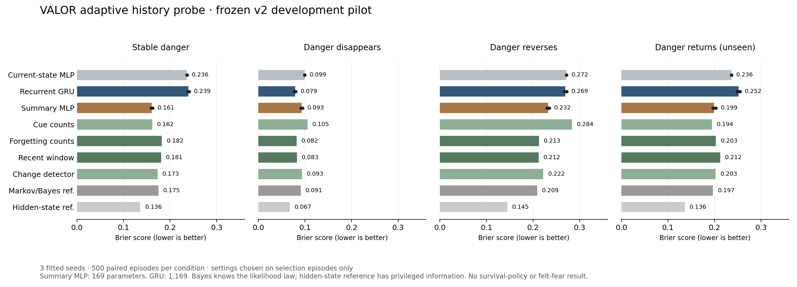

# Build report 09 — adaptive memory and returning danger

**Date:** October 12, 2026. **Status:** frozen v2 development pilot completed; overall research build in progress.

## Outcome

VALOR now trains on changing danger and compares recurrent memory against stronger simple controls: forgetting counts, recent windows, a change detector and a known-law Markov/Bayes reference. A new 169-parameter summary MLP uses explicit public-history features. Hidden change schedules stay outside predictor inputs. V1 data, checkpoints and negative result are retained.

The compact summary model substantially outperforms the raw 1,169-parameter GRU under stable danger and reversal, with **85.5% fewer parameters**. That is useful engineering progress, but it does not beat the adaptive controls consistently. Recent-window counts achieve mean Brier **0.15849** across the three trained condition types, versus **0.16208 for the summary model** and **0.19558 for the GRU**. This is a descriptive equal-condition average, not a final hypothesis test.

Returning danger is still a major limitation. On high-probability recurrence queries whose true simulator damage probability is 0.65, mean forecasts are approximately **0.202 for the GRU and 0.338 for the summary model**. Neither should authorize actions. Subjective fear, survival-policy advantage and AACE's counterfactual-memory hypothesis remain unestablished.

All **180 regression tests passed in 31.04 seconds**. Three measured fits took **25.76 seconds total**, with sampled process memory below **278.17 MiB**. External spend remains **$0**. Source, frozen protocol, figures and curated measurements were pushed during work; raw models/data remain local.

## Implemented

- `src/aace/benchmarks/adaptive_history.py`: mixed stable/extinction/reversal fitting episodes, variable hidden change times, separately checked recurrence, audit-only schedules, hashes, new episode groups and repaired-body invariants.
- `src/aace/learning/adaptive_controls.py`: selection-only control grids, forgetting/window estimates, per-cue cumulative-residual change detection, a likelihood-law Markov reference and validation of recorded setting selection.
- `src/aace/learning/history.py`: explicit v2 opt-in, versioned checkpoint/task contracts, summary features/head, adaptive control selection, conditional forecast bias and source/prediction records. V1 remains the default and cannot silently load v2 data.
- `collect-adaptive`, `train-history --adaptive`, and automatic task selection during `evaluate-history` expose individual stages.
- `scripts/Run-AdaptiveHistoryPilot.py`: complete frozen three-seed reproduction with incremental records.
- `scripts/Plot-AdaptiveHistoryPilot.py`: actual measurement figure, retained as PNG/SVG and visually reviewed.

The [protocol](../01_Architecture/ADAPTIVE_HISTORY_PROTOCOL.md) was committed before implementation and check measurements. No recipe adjustment or second tuned pilot followed the check results.

## Task and information boundary

Keep two visible cues, twelve encounters, six public features and a final pre-action query. One cue has probability 0.65 of damage; the other 0.05. Observed damage reduces integrity by 0.25 and costs two recovery units. The controlled harness repairs and replenishes between encounters, intentionally matching present body variables after different histories. It is not free repair in a mission environment.

Training and selection uniformly sample stable danger, extinction and reversal, with hidden change times from encounter indices 4–9. Extinction makes both cues low-risk; reversal swaps dangerous cue roles. The unseen recurrence pattern becomes safe at indices 4–6 and restores original cue danger at indices 9–11. Predictors never see regime identifiers, change times, reference probabilities, seeds or future outcomes as inputs.

Each current query has health/resources 1 and harm/exposure-completed 0. Hidden schedules are a separately hashed audit file, validated but excluded from returned model data. Stable and recurrence checks have identical current queries, latent query probabilities and query event labels, while their histories differ. The audit verifies this pairing explicitly.

## Data

| Group | Episode records | Episode seeds | Query damage events |
|---|---:|---|---:|
| Training, mixed | 3,000 | 3,000–5,999 | 761 |
| Selection, mixed | 500 | 11,000–11,499 | 116 |
| Stable check | 500 | 14,000–14,499 | 174 |
| Extinction check | 500 | Same paired check seeds | 36 |
| Reversal check | 500 | Same paired check seeds | 210 |
| Recurrence check | 500 | Same paired check seeds | 174 |

Training includes 1,057 stable / 992 extinction / 951 reversal episodes; selection includes 168 / 167 / 165. Neither includes recurrence. There are 5,500 records, with 500 paired check subjects across four conditions, not 2,000 independent check subjects. New actual episode groups do not overlap v1's used groups. The reserved [20,000, 30,000) test range remains untouched.

## Models and control selection

| Learned head | Parameters |
|---|---:|
| Current-state MLP | 113 |
| Full-history linear | 79 |
| Full-history MLP | 1,121 |
| Recurrent GRU | 1,169 |
| Summary MLP | 169 |

The summary head receives query-cue exposure/event summaries, recent-four summaries, other-cue rates, total harm rate and current cue/body/resource variables. They are explicit feature engineering from the same observed sequence. They are not privileged state or an emotional measurement.

All learned heads share data, batches, 600 updates per fit, optimizer rate 0.001, output-prior initialization and checkpoint opportunities. Epoch zero is eligible. Parameter count, information representation and computation differ; this does not equalize all work.

Each simple family is fitted by selection log loss only. All three fits independently reproduce the same settings:

| Family | Candidates | Selected setting |
|---|---:|---|
| Cue counts | 3 | Training-event prior, strength 4 |
| Forgetting counts | 12 | Decay 0.5, prior strength 1 |
| Recent window | 12 | Last 4 encounters, prior strength 2 |
| Per-cue change detector | 3 | Residual threshold 0.75, drift 0.05, prior strength 2 |
| Markov/Bayes reference | 4 | Regime transition mass 0.15 |

The prior uses training query-event prevalence only. Counts of selection trials and their scores are retained, and loading rejects settings inconsistent with the recorded selection minimum. The simple grids have 3–12 candidates per family versus 26 eligible learned checkpoints; search computation is recorded rather than advertised as equal.

The Bayes reference knows the observation likelihood law, but not actual schedules, hidden states or future events. Its Markov transition assumption is not the exact task generator. The hidden-state reference is privileged and is only a scoring reference. No winning family is selected separately for each check condition as a deployable policy.

## Results

Mean Brier across fitted seeds 42, 43, 44; lower is better.

| Predictor | Stable | Extinction | Reversal | Recurrence, unseen |
|---|---:|---:|---:|---:|
| Current-state MLP | 0.23629 | 0.09931 | 0.27184 | 0.23629 |
| Full-history linear | 0.23729 | 0.09056 | 0.27142 | 0.24159 |
| Full-history MLP | 0.23942 | 0.08294 | 0.26962 | 0.24963 |
| GRU | 0.23908 | **0.07871** | 0.26896 | 0.25180 |
| Summary MLP | **0.16080** | 0.09320 | 0.23226 | 0.19904 |
| Summary MLP, shuffled history | 0.29908 | 0.09485 | 0.29210 | 0.27753 |
| Cue counts | 0.16206 | 0.10549 | 0.28371 | **0.19449** |
| Forgetting counts | 0.18246 | 0.08188 | 0.21290 | 0.20308 |
| Recent window | 0.18059 | 0.08282 | **0.21206** | 0.21214 |
| Change detector | 0.17340 | 0.09338 | 0.22201 | 0.20251 |
| Markov/Bayes reference | 0.17504 | 0.09113 | 0.20913 | 0.19681 |
| Privileged reference | 0.13618 | 0.06730 | 0.14482 | 0.13618 |



The GRU's lower extinction score does not establish general superiority: its paired GRU-minus-window episode intervals include zero for fitted seeds 42 and 43, and are negative for 44. Under stable/reversed/returning danger, those intervals are positive for all three fits. Each interval describes one fitted model's paired development episodes and omits broader training-seed variability.

The summary model separates cue danger much better than the raw recurrent recipe. On stable high-probability queries it predicts about 0.510, while on low-probability queries it predicts 0.075. The GRU averages about 0.262 and 0.268 respectively: it mainly reflects broader history rather than distinguishing the query cue reliably in this frozen recipe. Shuffling histories across episodes within a condition markedly worsens the summary model. That ablation retains the condition's distribution; it is not removal of all information about a shared condition.

All predictors still have biases. After extinction the GRU averages 0.176 despite a true simulator probability of 0.05. After danger returns, its high-probability mean falls to 0.202 rather than 0.65; the summary model also underpredicts at 0.338. These are prediction errors, not observed avoidance or courage. Such behavior has not been coupled to actions in this pilot.

Across the three trained condition types, descriptive mean Brier is 0.18375 for plain counts, 0.15908 for forgetting, 0.15849 for windows, 0.15844 for the known-law reference, 0.16208 for the summary MLP and 0.19558 for the GRU. The learned compact model helps, but the strongest simple adaptive controls remain competitive or better.

V1/v2 score differences are not an apples-to-apples model comparison: training distribution, schedules, episode groups and controls changed. Results apply to these frozen recipes on this small constructed task. Check results were not used to retune them or authorize a production model. Reliability bins and the extinction check's 36 events do not establish individual risk calibration.

## Verification and resources

| Fitted seed | Training seconds | Peak sampled MiB | Selected GRU / summary epochs |
|---|---:|---:|---|
| 42 | 10.33 | 267.80 | 25 / 25 |
| 43 | 6.74 | 273.30 | 24 / 25 |
| 44 | 8.69 | 278.16 | 23 / 25 |

CPU, two PyTorch threads, Python 3.13.1 / PyTorch 2.7.1+cpu / NumPy 2.2.5. Per-fit limits: 25 epochs, 120 seconds, 1,024 MiB sampled process memory. Training measurements include preparation, control selection and selection evaluation within the function, excluding initial process/framework import. Budget checks are cooperative. Model batch timings follow a warmup; control timings do not use a dedicated warmup. They are not single-request latency or deadline guarantees.

Sixteen new checks, plus the existing nineteen history checks, cover hidden schedules, reproducibility, query pairing, v1/v2 separation, adaptive response, selection-only grids, compact summaries, real training/reload/streaming, expired budgets and unrecorded tuning rejection. Focused suite: **35 passed in 18.05 seconds**. Complete suite: **180 passed in 31.04 seconds**. Compilation and whitespace checks passed.

All six datasets and schedule files passed hash/invariant audits. Three models load with verified hashes. All twelve prediction bundles reproduce their reported scores; control settings reproduce from selection-only inputs. Source was clean at `dbf2dd1`. Full curated measurements and intervals: [metrics](2026-10-12-build-09-metrics.json).

Offline wheel: `artifacts/packages/build-09/valor_aace-0.1.0-py3-none-any.whl`, **116,092 bytes**, SHA-256 `7a24729d7c887112b96f2167851e037b64f9e8070d33c510ca7b331a6309b3a6`. New/updated modules, all static assets and LICENSE/NOTICE match source. It reused setuptools 78.1.0 offline without build isolation, rather than the isolated declared 80.3.1. Fresh-machine installation/publication remain untested. Earlier wheels, data and models were retained separately.

## Git, reproduction and application

Three intermediate commits were pushed: `2a1d8fc` (frozen protocol), `dbf2dd1` (tested implementation), `632b591` (actual results/figure). This report and current-status documents form the final separate commit. No package, full dataset or model publication, external deployment or repository visibility change occurred.

Reproduce from the project root with the existing optional learning environment:

```powershell
.\.venv\Scripts\python.exe scripts/Run-AdaptiveHistoryPilot.py
```

The completed index is `artifacts/adaptive-history-pilots/pilot-v2-0a91c83b/index.json`. New runs create distinct directories. Source/protocol/curated measurements/figures are committed; weights, complete datasets and per-episode predictions remain in ignored local artifacts. No training job remains active.

The premium main app still opens through **Start VALOR.cmd**, then **Try VALOR**. These experimental predictors have no action authority and are not added to the demo's existing analytic decision core. This session changed no UI. Its persistent Scale-inspired product direction remains in force. The prior rendered desktop/phone review is still pending under the saved local browser permission block; no workaround was attempted.

## Decision and next steps

Keep the compact history representation and adaptive count controls as serious candidates. Do not adopt this GRU recipe as the survival model. The checks support feature engineering and expose return-to-danger errors, not machine feeling or a production advantage.

Next, freeze an offline decision rehearsal that exposes proposals from these predictors under identical fixed task objectives, budgets and an explicitly labeled independent guard. Measure completion, damage, unnecessary avoidance, recovery cost and decision work, including recurrence. Experimental probability outputs must remain outside the existing core's action permission; shadow/proposal results are not deployment authorization. Qualified risk learning and counterfactual-memory comparisons remain separate gates.

No paid service or additional owner input is needed for that research stage. The broader project remains unfinished, with no calibrated survival policy, subjective fear or AACE advantage established.
