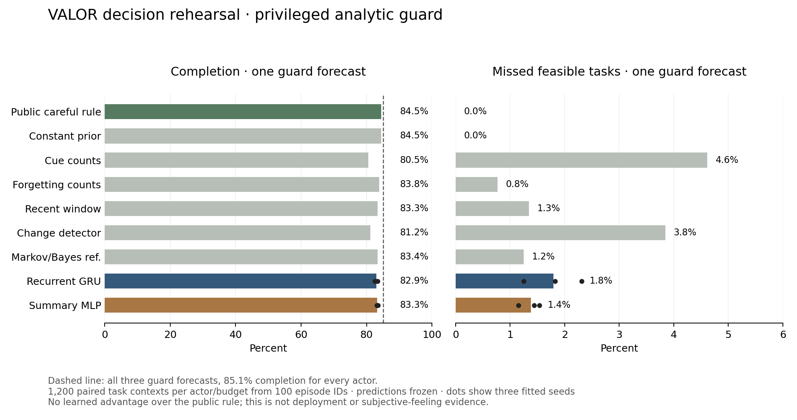

# Build report 10 — learned proposals and guarded task behavior

**Date:** October 12, 2026. **Status:** frozen offline development rehearsal completed; research build continues.

## Outcome

VALOR now connects frozen learned history estimates to actual simulated task choices through the existing decision engine. Estimates rank proposals; a separate analytic guard supplies action evidence, and the existing authority checks the handoff. The simulator records completed work, irreversible failure, harm, repair, abandonment and abstention. This is a causal behavior experiment beyond prediction scores, although its guard has privileged simulator information.

The strongest simple public rule wins this comparison. With one guard forecast, it completed **1,014/1,200 task contexts (84.5%)**, versus mean **995.3/1,200 (82.94%) for the recurrent GRU** and **999.7/1,200 (83.31%) for the summary MLP** across three frozen fitted seeds. A constant training-event prior also matches the public rule. Evaluating all three alternatives removes actor differences completely: every actor completes **1,021/1,200 (85.08%)** with the same paired outcomes.

The result demonstrates working proposal-to-behavior coupling, but supplies **no learned survival advantage over the strong simple control**. Subjective fear, calibrated learned risk, general transfer and AACE's counterfactual-memory advantage remain unestablished. It would be premature to treat this milestone as validation of a commercial decision product.

**204 regression tests passed in 55.10 seconds.** The 38,400-rehearsal pilot took **37.93 seconds**, with **249.41 MiB sampled peak process memory**, two CPU threads and **$0 external spend**. No model was trained in this milestone. The premium main demo remains the separate analytic service study; these learned proposals have not been silently added to it.

## Implemented

- `src/aace/benchmarks/rehearsal.py`: finite fast/careful/preserve workload, independent indexed future noise, full-plan consequence transforms, privileged analytic guard, experimental ordering, fixed public controls and actual execution through the core authority.
- `src/aace/learning/rehearsal.py`: frozen v2 model/control loading, exact recipe/version/hash checks, bounded inference, streaming episode records, work accounting, aggregate outcomes and paired episode bootstrap comparisons.
- `scripts/Run-DecisionRehearsal.py` and `aace decision-rehearsal`: bounded offline reproduction. The basic simulator/demo does not require the optional neural stack.
- `tests/test_rehearsal.py`: 24 checks, including misleading estimates, qualified evidence, stop/stale-state handoff, public controls, repaired harm, nonzero outage, urgency, resource/time invariants, grouped statistics and frozen recipe rejection.
- `scripts/Plot-DecisionRehearsal.py`: actual measurement chart with three fitted-seed dots, retained as PNG/SVG and visually checked.

The [protocol](../01_Architecture/DECISION_REHEARSAL_PROTOCOL.md) was committed before implementation and measurement. A stronger public-feasibility comparator was added before measurement, increasing the original plan to sixteen actors. No model, actor or simulator recipe was retuned after the pilot. Grouped bootstrap reporting and stricter loading checks were added afterward without changing measured episodes.

## How the experiment works

Each subject receives twelve public cue encounters from the adaptive history generator, followed by a repaired-body query. Predictors receive only this observed sequence. The generator's later query event label is ignored; a separate independent random stream determines actual workload outcomes. No seed, hidden schedule, latent danger assignment or future event is a learned input.

Frozen GRU and summary heads, simple history estimators and the constant prior estimate query-cue danger. Common experimental transforms rank three complete plans under a fixed objective. This ranks search proposals only. The guard uses the actual latent simulator probability, 0.05 or 0.65, and declared transition laws; it does not inspect future random draws. The existing `DecisionEngine` evaluates qualified evidence, and `ActionAuthority` checks stop, state identity and deadline again before application.

Fast performs three operations producing two work units each. Careful performs six operations producing one each. Both seek six completed units. Fast costs two resources/one second per operation; careful costs one resource/two seconds. Fast per-operation outage probability is 0.05 times cue danger; careful is 0.005 times cue danger. Recoverable harm probabilities are cue danger and 0.1 times cue danger, respectively, with damage magnitudes 0.15 and 0.05.

Repair after successful processing costs two resources/one second per 0.15 integrity restored, rounded up. Maximum processing plus repair costs are 12 resources/6 seconds for fast and 10 resources/14 seconds for careful. Experienced harm remains in the record after integrity returns to 1. Outage and harm streams are independent and shared by operation index across actors; different plan lengths expose different numbers of events.

Forecast success, outage and expected harm describe the nominal complete continuation. Worst-case time/resource feasibility is assessed separately. This does not claim a calibrated deadline-truncated success probability for a rejected plan. Accepted plans were independently checked against actual time, reserve and repaired-capability invariants.

Three public situations use quota/deadline pairs of 18/16, 14/16 and 18/6. All actors use task value 30, harm cost 12, outage cost 40, time cost 0.1, full-plan outage limit 0.05, remaining reserve 3 and capability floor 0.15. Urgency slack remains 2, with minimum necessary processing time 3. These predefined situations produced no urgency overrides; a separate unit check exercises the existing urgency mechanism.

The public careful-first control needs no danger prediction: try careful if its worst-case time and resource requirements fit, otherwise fast, then preserve. With one guard forecast, the first evaluated plan is the only opportunity. With three, the engine evaluates all alternatives. A rejected sole proposal results in abstention; selecting preserve explicitly abandons the task. A retrospective three-plan oracle audit labels whether completion was feasible and whether a feasible task was missed. That audit never influences actor choice.

## Cohort and work accounting

| Item | Measured scope |
|---|---|
| New paired episode IDs | 100, seeds 16,000–16,099 |
| History conditions | Stable, extinction, reversal, recurrence |
| Public contexts | Normal, reserve pressure, time pressure |
| Guard budgets | One or three forecasts |
| Actors | Six frozen fitted heads, five history controls, constant prior, four public fixed rules |
| Total records | 38,400 unique actor/context/condition/budget/seed combinations |
| Per actor and budget | 1,200 contexts; 1,040 audit-feasible and 160 infeasible |
| Saved full example traces | 384 |
| Qualified guard forecasts | 76,800 |
| Experimental/structural proposal transforms | 93,600 |
| Separate retrospective audit forecasts | 115,200 |

These are **100 paired episode IDs**, not 38,400 independent subjects. All twelve condition/context combinations for an episode stay together in pooled bootstrap comparisons. Fitted seeds 42/43/44 are separately reported, not treated as independent episode replications. Intervals measure development episode sampling uncertainty for a frozen fit and exclude training-seed uncertainty.

Guard forecast budgets are matched; total computation is not. Predictors and probability-based actors perform inference plus three experimental plan transforms. The public careful rule performs three structural transforms, while always-fast/careful/preserve require no proposal transforms. Audit work is extra reporting work for every actor. These distinctions are retained in the records.

No data/model selection occurs here. Training/selection and earlier check groups stay separate. The reserved final-test seeds [20,000, 30,000) remain untouched. Whole-pilot caps were 180 seconds and 1,024 MiB sampled process memory; checks are cooperative.

## One-forecast results

Each row has 1,200 contexts. Completed and irreversible failed are actual applied outcomes. Abandoned means preserve was selected; abstained means the only evaluated task proposal could not be applied. Missed feasible counts refer to the 1,040 audit-feasible contexts.

| Actor | Completed | Failed | Abandoned | Abstained | Missed feasible |
|---|---:|---:|---:|---:|---:|
| Public careful rule | 1,014 | 26 | 0 | 160 | 0 |
| Constant prior | 1,014 | 26 | 0 | 160 | 0 |
| Always fast first | 480 | 0 | 0 | 720 | 560 |
| Always careful first | 774 | 26 | 0 | 400 | 240 |
| Always preserve first | 0 | 0 | 1,200 | 0 | 1,040 |
| Cue counts | 966 | 26 | 133 | 75 | 48 |
| Forgetting counts | 1,006 | 26 | 86 | 82 | 8 |
| Recent window | 1,000 | 26 | 96 | 78 | 14 |
| Change detector | 974 | 26 | 147 | 53 | 40 |
| Markov/Bayes reference | 1,001 | 26 | 105 | 68 | 13 |
| GRU seed 42 | 995 | 26 | 30 | 149 | 19 |
| GRU seed 43 | 990 | 26 | 37 | 147 | 24 |
| GRU seed 44 | 1,001 | 26 | 23 | 150 | 13 |
| Summary MLP seed 42 | 999 | 26 | 104 | 71 | 15 |
| Summary MLP seed 43 | 998 | 26 | 107 | 69 | 16 |
| Summary MLP seed 44 | 1,002 | 26 | 92 | 80 | 12 |

The learned heads' missed feasible tasks were explicit false abandonments. The always-fast/careful controls instead miss tasks through an unsuitable first proposal and exhausted search. Apparent preservation can therefore be excessive caution rather than useful survival behavior. The constant prior's match also shows that history prediction is unnecessary for the strong result on this constructed task.

For example, the paired episode bootstrap for GRU seed 42 gives completion difference versus the public rule of −1.58 percentage points, with a development 95% interval of [−2.25, −1.00]. Summary seed 42 gives −1.25 points [−2.08, −0.665]. These are descriptive frozen-fit comparisons, not final confirmatory tests or intervals over new training runs. Complete per-context and clustered measurements are in [the metrics file](2026-10-12-build-10-metrics.json).

With three forecasts, every actor has **1,021 completed, 19 failed, 160 abandoned, zero abstained and zero missed feasible**. Auditing every paired case confirms identical outcomes, not just matching totals. Mean task elapsed time is 6.940 simulated seconds. The realized failure count differs between budgets, but this small indexed-noise cohort does not establish a general risk reduction. A nonzero permitted outage bound can still produce irreversible failures.



## Verification and reproducibility

- Final full regression: **204 passed / 55.10 seconds**, including the exact frozen recipe gate. The earlier 203-test run and 22 targeted behavior checks are preserved in metrics.
- Independent record audit verified 38,400 unique combinations, exact seed scope, aggregates, artifact hashes and unchanged three-forecast paired outcomes.
- All completed tasks have six work units, at least three remaining resources and repaired integrity 1. No applied runs produced unexpected resource/deadline violations or stale/deadline handoff events.
- All 384 saved examples retain fixed policy, analytic evidence for applied actions and experimental proposal evidence. Optimistic predictions cannot replace qualified guard evidence. Stop/stale/unqualified evidence suppression has explicit regression coverage.
- Scientific figure visually checked; compilation and whitespace checks passed. No UI files changed.
- Offline wheel includes exact new source, static assets and Apache license/NOTICE texts. Final package: `artifacts/packages/build-10-final/valor_aace-0.1.0-py3-none-any.whl`, 123,915 bytes, SHA-256 `99ee7b861b3e81f43e1e0e10162680edc4dcde452f1f0dcc61abb561ae36f92a`. The earlier build-10 wheel is retained separately. Build used no dependencies/index/isolation with local setuptools 78.1.0 rather than declared isolated 80.3.1; fresh install/publication remains untested.

Measured pilot source was clean commit `6428bda74f43c8ff537ca75396632e075961a509`. Raw output is `artifacts/decision-rehearsals/pilot-rehearsal-240d1684/`, including `report.json`, episode JSONL, traces and frozen prediction/probe arrays. Its report SHA-256 is `9dbc307a0ed3321e5a0b2e8b473a6dce5eb69e682d2591d49107fcc63ac6d07c`. Frozen v2 fit index is `artifacts/adaptive-history-pilots/pilot-v2-0a91c83b/index.json`.

On this workspace, with its optional learning dependencies and retained fitted artifacts:

```powershell
.\.venv\Scripts\python.exe scripts/Run-DecisionRehearsal.py --pilot-index artifacts/adaptive-history-pilots/pilot-v2-0a91c83b/index.json
```

Use `--smoke` for two separate engineering subjects. The completed smoke contains 768 records and is not the measured pilot. A fresh checkout needs an adaptive v2 fit index created with `scripts/Run-AdaptiveHistoryPilot.py`; models and raw data are local ignored artifacts, not downloaded automatically. New reproduction outputs record their own source identity. Reporting improvements after the measured run do not rewrite its original report.

## Limitations and next gate

The guard knows hidden simulator risk. The predictor learns a cue probe, while task action effects are explicit hand-specified transforms. Prelude repair/replenishment is artificial; danger remains fixed during workload execution. Heads are frozen and receive no learning update from chosen action feedback. Plans are short atomic batches, and stop/resource checks are cooperative rather than hard interruption. No real tools, services or devices are controlled.

The result favors a simple public rule under the declared objective and constrained workload. It cannot establish that learned fear is unnecessary in other tasks, nor justify adding neural complexity here without a discriminating improvement. AACE reflection/counterfactual memory is still unimplemented and needs its own matched comparison.

Next, freeze a protocol for **action-conditioned public-history consequence evidence** and compare it against the strongest simple control. Measure unsupported regions, distribution shift and conservative bounds before replacing privileged guard evidence. Keep learned proposal ranking separate from action permission until this qualification succeeds. A product demonstration should expose those boundaries and real outcomes in the existing premium interface; it should not imply subjective feelings or turn this negative result into a success claim.

Browser visual review of the local interface remains pending under the saved local-address permission block. This milestone does not alter or bypass that setting. No additional hardware, account or spending is required from the owner for the current offline research work.

## Version control and stopping state

Three meaningful intermediate commits were pushed to `origin/main` during this milestone: `d46ce5f` (frozen protocol), `6428bda` (behavior implementation before measurement), and `f4f1c0d` (measurements, grouped comparisons and figure). This report and current-status documents form the fourth commit. Source/protocol/tests/curated results/figures are versioned; raw checkpoints/data/wheels remain local ignored artifacts.

All training/rehearsal/test/package jobs are finished. The final handoff verifies clean local status and matching local/remote Git revisions. No deployment or publication was performed; the overall project remains in progress.
