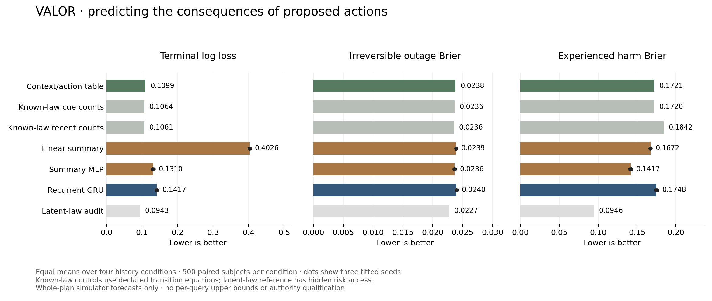

# Build report 11 — predicting consequences of proposed actions

**Date:** October 12, 2026. **Status:** frozen continuation prediction pilot complete; VALOR research continues.

## Outcome

VALOR now trains a scoped model of the consequences of a specific proposed action from public history and task context. It predicts completion, irreversible outage, deadline/resource failure, experienced harm, work done, repair costs, resource use, elapsed time and final integrity. This closes an important gap between estimating cue danger and predicting what an action actually does.

The compact summary model improves experienced-harm forecasting: mean Brier **0.141724 versus 0.172063 for the context/action table**, a **17.63% relative reduction in prediction score**, across three frozen fits and four paired history conditions. This is not a 17.63% reduction in damage, outages or risk. The model's terminal log loss is worse than the table (**0.130977 versus 0.109876**), and strong known-law controls remain better on outage forecasting. The recurrent recipe remains weak. There is no broad learned survival, subjective-fear or AACE claim.

Preview inspection also exposed inconsistent predictions across separate model outputs. A post-measurement public-law audit finds at least one contradiction in **every one of the 12,000 check contexts for every learned fit**; the empirical table and all known-law references pass these checks. No predictions were corrected and no model was retrained. Better harm scores therefore do not establish a physically coherent continuation model. The audit and preview warnings now make that failure explicit.

Twelve structured consequence previews separate predicted branches from actual offline interventions. These are whole-plan expected quantities and outcome distributions, not a stepwise movie, a recording of thoughts, or a working external-agent integration. Every model and preview remains **`decision_ready: false`**. A core-contract check confirms that even accurate experimental forecasts cannot authorize an action without qualified evidence and a risk upper bound.

The owner-confirmed [agent proctor direction](../01_Architecture/AGENT_PROCTOR_DIRECTION.md) is now recorded: supervise consequential agent proposals, combine learned vulnerability/history with explicit logic, and make anticipated consequences inspectable in the existing premium product language.

**226 regression tests passed in 36.84 seconds.** The complete pilot took **89.25 seconds**, of which **78.93 seconds** were measured fitting, with **287.44 MiB sampled peak process memory**, two CPU threads and **$0 external spend**. Main UI and existing action authority are unchanged.

## Implementation

- `src/aace/benchmarks/continuation.py`: versioned action-conditioned datasets, public input/target separation, separate audit metadata, episode ranges, hash and scope validation, and exact declared-law integration including early termination.
- `src/aace/learning/continuation.py`: linear summary, compact summary MLP and recurrent heads; joint categorical/event/quantity losses; selection-only checkpoints; restricted weight loading; strong context/action and public-history references; reliability diagnostics; structured previews and an experimental core-contract wrapper.
- `src/aace/learning/continuation_pilot.py`: incremental frozen three-fit orchestration, paired subject comparisons, per-condition/context/action results, explicit qualification gaps, saved predictions and twelve example previews.
- `scripts/Run-ContinuationPilot.py` and `aace continuation-pilot`: full pilot or separate small engineering smoke.
- `tests/test_continuation.py`: twenty-two additional checks, including exhaustive path integration, absence of audit/labels from inputs, scope/hash rejection, real updates, checkpoint reproduction, authority refusal, reliability boundaries, preview boundaries, retained partial work after a budget failure and public-law consistency diagnostics.
- `scripts/Plot-ContinuationPilot.py`: actual measured scientific figure, exported as PNG/SVG and visually checked.

The [protocol](../01_Architecture/CONTINUATION_MODEL_PROTOCOL.md) was frozen and pushed before implementation and measurement. One recipe was run. No retry, model selection on checks, post-result neural architecture change or calibrated-authority promotion followed the results. The subsequent public-law audit adds diagnostics to unchanged predictions.

## Task, data and public information

The previous rehearsal simulator is unchanged. Twelve cue encounters precede a repaired-body query. Public model inputs are the 13-by-6 observed sequence and four plan/context values: quota/18, deadline/16 and two action indicators. Latent risk, hidden regime, episode identity, future query label, future draws and outcomes are excluded from predictor inputs. Observed outcome arrays are supervised targets; audit arrays are validated but not returned in model data.

Each subject is intervened on in all six context/action combinations: normal/reserve/time pressure crossed with fast/careful. Direct offline simulator execution includes structurally unsuitable actions to observe deadline endings. This data harness is not an approved agent executor. Indexed task noise is independent of history generation and shared across paired interventions.

The output contains four competing terminal probabilities; probability of any experienced harm; and six normalized expected quantities. Outputs describe actual early termination, rather than assuming every proposed plan completes. Integrity may return to 1 after recovery while recorded experienced harm remains nonzero.

| Dataset | Subjects | Action records | Seeds | Completed / outage / deadline / resource endings |
|---|---:|---:|---|---|
| Training, mixed | 3,000 | 18,000 | 40,000–42,999 | 14,642 / 364 / 2,994 / 0 |
| Selection, mixed | 500 | 3,000 | 50,000–50,499 | 2,419 / 83 / 498 / 0 |
| Stable check | 500 | 3,000 | 60,000–60,499 | 2,412 / 91 / 497 / 0 |
| Extinction check | 500 | 3,000 | Same paired check seeds | 2,489 / 12 / 499 / 0 |
| Reversal check | 500 | 3,000 | Same paired check seeds | 2,402 / 102 / 496 / 0 |
| Recurrence check | 500 | 3,000 | Same paired check seeds | 2,412 / 91 / 497 / 0 |

Training/selection mix stable, extinction and reversal; recurrence is absent from fitting. **12,000 check action records come from 500 paired episode IDs**, not 12,000 independent subjects. Stable/recurrence share current queries, final latent probabilities and actual work outcomes while observed prelude histories differ. The reserved final-test [20,000,30,000) range is untouched. Engineering smoke uses separate 70,000/71,000/72,000 ranges.

There are **zero resource-exhaustion examples** in this fixture. Its quotas remain sufficient for actual processing/repair even when reserve constraints would reject a plan. The resource-failure output therefore has no positive-event validation; it cannot support deployment claims about depletion.

## Frozen models and references

| Head | Parameters | Representation |
|---|---:|---|
| Linear summary | 165 | Ten public-history summaries plus public context/action |
| Summary MLP | 635 | Same inputs, 24 hidden units |
| Recurrent GRU | 1,931 | Six public observations per encounter, 16 recurrent units and a 24-unit context/action head |

All three heads share subject batches, data, optimizer rate 0.001, twenty epochs, 480 updates per model per fit and checkpoint opportunities. History encoding runs once per subject and is shared across its six plans. Epoch zero is eligible; global training priors initialize final outputs. The selection loss is terminal cross entropy plus binary harm cross entropy plus mean normalized quantity MSE. Every selected head used epoch twenty in this measured recipe. Equal opportunities do not mean equal parameters, representation or computation.

The primary stateless comparator is a training-only empirical outcome/quantity table for each of the six public context/action cells. Strong public-history controls combine all cue-matched or recent-four counts, each with Beta(1,1) smoothing, with exact declared transition equations. They use the same observed history, but have hand-specified physics the learned heads must infer from data. A latent-law reference knows hidden danger and is audit-only. Its nonzero loss reflects stochastic outcomes; it is not a deployable learner.

Exact integration was independently checked against exhaustive actual simulator paths for every context/action, including the deadline check before a subsequent event, outage before harm, and recovery after processing. Reference computation is cached for repeated probability/context/action inputs and separately timed; it is not matched neural compute.

## Measurements

Numbers below are equal-condition means; learned rows also average scores across fitted seeds 42/43/44. They are descriptive score averages, not an ensemble or confidence interval over new training runs. Lower is better.

| Predictor | Terminal log loss | Outage Brier | Experienced-harm Brier | Normalized quantity RMSE |
|---|---:|---:|---:|---:|
| Context/action table | 0.109876 | 0.023796 | 0.172063 | 0.167403 |
| Known-law all counts | 0.106446 | 0.023632 | 0.171993 | 0.163084 |
| Known-law recent counts | 0.106082 | 0.023556 | 0.184233 | 0.162341 |
| Linear summary | 0.402576 | 0.023890 | 0.167181 | 0.191240 |
| Summary MLP | 0.130977 | 0.023624 | 0.141724 | 0.165085 |
| Recurrent GRU | 0.141704 | 0.023970 | 0.174844 | 0.177174 |
| Privileged latent-law audit | 0.094339 | 0.022713 | 0.094616 | 0.122513 |

The summary head learns useful harm-related distinctions under this recipe. It is not the best terminal predictor, outage predictor or quantity predictor. The linear head struggles with terminal outcomes, while the recurrent head fails to improve materially on the stateless table. This experiment does not isolate emotion, establish a recurrent-memory advantage or validate counterfactual reflection.

Mean summary harm Brier by condition is stable 0.133014, extinction 0.103639, reversal 0.165990 and recurrence 0.164251. For seed 42, combined loss versus the empirical table has paired development intervals entirely below zero under stable/reversal/recurrence; extinction includes zero. That combined objective mixes easier outcomes with harm and quantity error, so it is not evidence of catastrophic-risk calibration. Complete fitted-seed, per-cell, per-quantity and reliability results are in [the curated metrics](2026-10-12-build-11-metrics.json).



## Qualification and preview boundaries

There are 2,232 repeated fast contexts with latent full-plan outage risk above the 0.05 policy limit. The summary fits assign point estimates at/below that limit to 1,443 / 1,393 / 1,418 of them. The table and each GRU do so in all 2,232; known-law all/recent counts do so in 603 / 495. These are diagnostic counts over paired contexts, not independent trials or actual authorized actions. Some plans also violate resource reserves independently. Every experimental action remains refused by the qualification boundary.

Reliability uses fixed outage bins separately per condition/context/action, with observed counts, mean forecasts and Wilson 95% intervals. Within one profile, check subjects are independent. Each profile totals 500 subjects; bins below 100 have insufficient descriptive support. Population-bin intervals are **not per-query failure upper bounds**, and do not establish shift coverage, robust applicability or a safety certificate.

Learned quantities are expectations, not conservative resource/time bounds. Thirteen public-law checks audit terminal support, elapsed-time bounds, progress, integrity, resources, recovery and harm. For example, a model cannot assign large completion probability to a twelve-second plan while predicting expected time below the minimum compatible with its terminal distribution. Every learned fit has a contradiction in each check context; all four non-learned references pass. This diagnostic was added after measurement, does not alter scores/predictions and is not a prospectively confirmed performance claim. No structural output projection or guarantee is claimed. The wrapper marks evidence experimental and leaves the failure upper bound unknown, preserving core refusal. No learned output replaces the privileged guard or changes human stop/permissions.

The twelve `previews.json` examples use the predeclared summary seed-42 model, with model/data hashes and no check-selected winner. Each contains two proposed branches, distributions and expected quantities. Actual observed offline interventions occupy a separate section and never enter prediction. These are structured exports only: the premium browser viewer has not been connected to them, and no rendered consequence animation is claimed.

A [curated preview](examples/continuation-preview-v1.json) adds the new audit to the unchanged first stable/normal example. Its fast branch predicts 96.58% completion and expected final integrity 0.945, below its completed probability mass; the careful branch predicts expected time 9.95 seconds despite completion probability 94.75% and minimum completion time twelve seconds. Both contradictions are flagged. In the separate actual interventions, fast completes with 0.45 harm and six recovery resources, while careful completes without harm. Individual sampled outcomes are not estimates of forecast accuracy; the algebraic contradictions are independently detectable from public laws.

## Verification, resources and reproduction

- Final complete regression: **226 passed / 36.84 seconds**, including twenty-two new checks. The earlier pre-measurement complete run passed 223 in 44.49 seconds. An initial restricted attempt passed 214 but blocked nine existing loopback HTTP checks with WinError 10013; authorized reruns with local socket access passed all tests. No browser permission workaround was used.
- Separate small smoke completed before measurement. Compilation and whitespace checks passed.
- Dataset/model/prediction/preview/report hashes, clean pilot source, split scope, exact frozen settings, capacities and 480 updates checked. Fifty-two saved prediction arrays and 312 reliability profiles were independently audited against targets and recorded scores.
- All twelve previews remain experimental, without risk bounds or action application. The core refusal regression includes a perfect reference prediction to prove accuracy alone cannot grant authority.
- Three fits took 41.42 / 23.37 / 14.14 seconds, respectively; total 78.93 seconds. Evaluation took 2.34 seconds; complete pilot 89.25 seconds. Runtime variance is not an architecture-speed comparison or latency guarantee. Package building overlapped part of fitting; memory is sampled per process, not total machine or GPU usage.
- Maximum sampled process memory was 287.44 MiB; no GPU/driver setup, paid API, cloud compute or hosting. External spend $0.
- Final offline package `artifacts/packages/build-11-final/valor_aace-0.1.0-py3-none-any.whl`: 138,096 bytes; SHA-256 `565fc1b50ee309fffa82aac55980f934135774052fe2675d9c88e3f8f9f07617`. Exact new source, static assets and LICENSE/NOTICE texts checked. The earlier build-11 wheel is retained separately. Build used no dependency download/index/isolation, with local setuptools 78.1.0 instead of declared isolated 80.3.1. Fresh-machine install/publication remains untested; prior wheels are retained.

Measured source is clean `405c639b5496b9e37e50e0f31a779288e4eec585`. The retained pilot index is `artifacts/continuation-pilots/pilot-continuation-e526ac4c/index.json`; its evaluation is `evaluation/continuation-evaluation-b24cf1a7/` beneath that directory. Raw datasets, checkpoints, prediction arrays, previews and wheels remain local ignored artifacts. Source, protocol, curated measurements and figures are versioned.

With the installed optional CPU learning stack:

```powershell
.\.venv\Scripts\python.exe scripts/Run-ContinuationPilot.py
# Separate engineering run:
.\.venv\Scripts\python.exe -m aace continuation-pilot --smoke
```

Each run creates a new directory and records source identity. No prior history pilot checkpoints are needed. Fresh checkout needs the documented optional learning dependencies. The existing main demo still opens with Start VALOR.cmd and uses analytic service forecasts; no interface-version change was made. Local browser visual review remains pending under the saved local-address permission block.

## Next gate

First test a physically coherent structured continuation model against this unchanged black-box recipe and strong known-law controls; separate learned unknowns from constraints already supplied by the domain. Then continue the proctor path with calibration/applicability evidence and a shadow adapter that records finite agent proposals without executing them. Include resource-exhaustion, changing capability and repeated action/recovery coverage before claiming general consequence forecasting. Do not promote a model based on its better harm average or add neural complexity merely because recurrent memory sounds more human.

A readable consequence explorer can then consume these structured records with visible experimental scope, uncertainty gaps and separate observed outcomes. Approval integration requires conservative action-specific evidence, current-state validation, task-specific permissions and an external execution boundary. The current Python core remains cooperative, not a hard real-time or rollback mechanism. Qualified AACE incident memory and its matched hypothesis tests remain separate work.

No additional hardware, account or spending is needed from the owner for current offline research. External-agent credentials, real execution permissions and production deployment are not requested or implied by this milestone.

## Version control and stopping state

Four meaningful intermediate commits pushed during work: `b7ffe18` (frozen protocol and proctor direction), `405c639` (tested implementation before measurement), `2664098` (scores, qualification gaps and scientific figure), and `04e356a` (public-law contradiction audit and preview warnings). This report and current-status documents form the fifth commit. Final handoff verifies clean local status and matching local/remote main.

All research, test, audit and package jobs are complete. No external action integration or deployment occurred. The overall VALOR build remains in progress.
