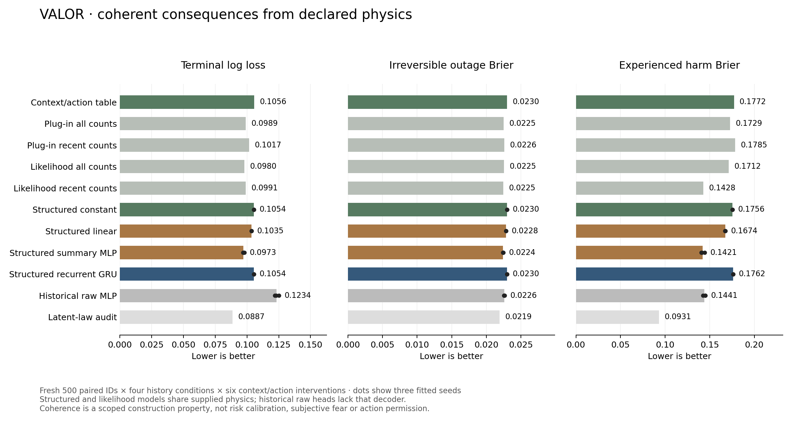

# Build report 12 — coherent consequences and learned history mixtures

**Date:** October 12, 2026. **Status:** frozen structured development pilot complete; overall VALOR research continues.

## Outcome

VALOR's structured consequence model eliminates the contradictory time, integrity and outcome forecasts found in report 11. A small learner estimates a public-history mixture weight; declared simulator laws derive every terminal probability and expected quantity from the same mixture. All twelve fitted structured heads pass the public-law audit in every one of their 12,000 fresh paired check contexts. The nine unchanged historical heads still produce a contradiction in every tested context.

Coherence comes from supplied physics and two declared danger hypotheses. It is a scoped construction property, not discovered world dynamics, calibrated risk, subjective fear or a learned survival-policy advantage. The registered decoder is audited separately from learned weights. No output has been promoted to action authority.

The 169-parameter summary MLP improves mean composite prediction loss from **0.658468 for the matched learned constant to 0.563735**, a **14.39% relative prediction-score reduction**. Terminal, outage and harm scores also improve over that constant. The strongest simple recent-count likelihood mixture is close at **0.567112**; the three MLP fits score **0.570627 / 0.559608 / 0.560970**. One fit loses to that reference on the descriptive average. This does not establish broad superiority over strong history controls, existing AI agents or deployed supervision products. The GRU does not improve the overall score over the constant.

**243 regression tests passed in 32.71 seconds.** The full pilot took **48.87 seconds**, including **42.92 seconds measured fitting**, with **298.29 MiB sampled peak process memory**, two CPU threads and **$0 external spend**. No main-interface change, external-agent execution, deployment or language-model training occurred.

## Direction and implemented work

The owner clarified that the learned mechanism itself is central: vulnerability and harmful experience should affect internal state and future behavior, with downstream consequences and meaningful recovery costs. [The intrinsic-stakes direction](../01_Architecture/INTRINSIC_STAKES_DIRECTION.md) records this alongside the existing [proctor direction](../01_Architecture/AGENT_PROCTOR_DIRECTION.md). Current structured forecasts are a prerequisite; trained intrinsic needs and general cascading world models remain future work.

- `src/aace/learning/structured.py`: constant/linear/summary/recurrent mixture heads, shared declared-law decoder, differentiable consequence loss, selection-only checkpoints, canonical buffer and capacity validation, public-scope prediction gate and an experimental core wrapper.
- `src/aace/learning/structured_pilot.py`: reuse of frozen fitting artifacts, strict source/data/weight gates, fresh checks, historical and physics-matched references, paired subject comparisons, reliability, contradictions and coherent previews.
- `src/aace/benchmarks/continuation.py`: explicit v2 check-schema opt-in and disjoint 80,000-range checks; old v1 schema/ranges remain the default and cannot silently load v2 checks.
- `scripts/Run-StructuredPilot.py` and `aace structured-pilot`: full frozen comparison or separate engineering smoke.
- `tests/test_structured.py`: seventeen checks covering a 501-weight mixture grid, nonlinear mixture versus plug-in distinction, parameter counts, public cue likelihoods, schema boundaries, real updates, checkpoint/decoder/source tampering, scope rejection, authority refusal and retained partial work.
- `scripts/Plot-StructuredPilot.py`: actual measured comparison figure, retained as PNG/SVG and visually checked.

The [protocol](../01_Architecture/STRUCTURED_CONTINUATION_PROTOCOL.md) was committed before implementation and new checks. A pre-measurement clarification corrected the terminology for the fixed two-state prior; no actor, capacity or recipe was changed after results. One three-seed recipe ran, with no check-driven retry or deployment selection.

## Why the new representation is coherent

For each declared context/action, exact simulator integration supplies an eleven-value outcome/moment vector under danger 0.05 and another under danger 0.65. The learner receives the observed 13-by-6 cue sequence and estimates weight w. Prediction is `(1-w) * low_consequences + w * high_consequences`.

Terminal outcomes, experienced-harm probability, work, damage, recovery, resource use, elapsed time and integrity therefore describe the same mixture of possible continuations. A twelve-second completion plan cannot simultaneously acquire an incompatible expected duration from a separate unconstrained head. Mixture prediction is not the same as applying nonlinear physics to average danger; the latter remains a separately labeled plug-in control.

The domain supplies transition laws and the two hypotheses. The learner does not see actual latent assignments, hidden schedules, episode IDs, future query labels, future noise or observed targets at prediction time. Targets are actual recorded offline interventions. Composite training is a sum of terminal cross entropy, harm binary cross entropy and six-quantity normalized MSE. Its learned weight is not claimed to be an exact latent posterior: outputs have shared noise, changing histories and a composite marginal objective.

The numerical scope remains narrow: repaired starting body, constant danger within a complete fast/careful plan, normal/reserve/time contexts, six work units and declared repair. Zero resource-exhaustion examples remain in the fixture. Neither the decoder nor a zero-contradiction audit validates arbitrary quotas, damaged starts, new hazards, unknown transitions or long-horizon cascades.

## Data, fits and fairness

Reuse unchanged v1 fitting data: **3,000 training subjects / 18,000 action records** on seeds 40,000–42,999, and **500 selection subjects / 3,000 records** on 50,000–50,499. Old 60,000-range checks informed the new representation and are not confirmation data. The frozen historical weights are reused without retraining or selecting new checkpoints.

New checks contain **500 paired IDs, seeds 80,000–80,499**, repeated across four history conditions and six context/action interventions. Thus 12,000 actual action records represent 500 paired subjects, not 12,000 independent trials. Reserved final-test [20,000,30,000) remains unused. Stable and recurrence share current queries, final latent risk and actual workload outcomes while history differs.

| Fresh condition | Completed | Outage | Deadline | Resource failure |
|---|---:|---:|---:|---:|
| Stable | 2,403 | 100 | 497 | 0 |
| Extinction | 2,491 | 9 | 500 | 0 |
| Reversal | 2,423 | 77 | 500 | 0 |
| Recurrence | 2,403 | 100 | 497 | 0 |

Each row comprises 3,000 paired context/action interventions, including unsuitable careful plans under the short deadline. These are data-harness interventions, not model-authorized agent actions.

| Structured head | Learned parameters |
|---|---:|
| Constant logit | 1 |
| Summary linear | 11 |
| Summary MLP, 14 hidden units | 169 |
| GRU, 16 recurrent units | 1,169 |

Every head starts at w=0.5. Each fit uses Adam 0.001, twenty epochs, batches of 128 subjects with all six plans, 480 updates per model and epoch-zero eligibility. All selected heads used epoch twenty. Caps are 120 seconds/1,024 MiB/two threads per fit, checked cooperatively. Four heads and three fits yield twelve trained models. Parameters, representation and actual compute are not equalized; decoder tensors are buffers rather than learned parameters.

Twenty-seven actors include twelve structured heads, nine frozen historical heads, a training-only context/action table, two known-law smoothed-count plug-in controls, two fixed public-history likelihood mixtures and one privileged latent-law audit. Shared simple references run once, not duplicated as independent fits. Likelihood controls use query-matched all/recent-four observations under a stationary two-state prior 0.5; they are not exact posteriors under changing danger. The learned constant is the primary physics-matched control. Historical heads lack the supplied structural decoder, so improvement over them does not isolate neural novelty.

## Measured scores

Equal-condition means; learned rows also average fitted-seed scores. These are descriptive score averages, not an ensemble or uncertainty over new training runs. Lower is better.

| Actor/group | Composite loss | Terminal log loss | Outage Brier | Harm Brier | Normalized quantity RMSE |
|---|---:|---:|---:|---:|---:|
| Context/action table | 0.662094 | 0.105626 | 0.022985 | 0.177180 | 0.166824 |
| Known-law all-count plug-in | 0.647502 | 0.098945 | 0.022502 | 0.172942 | 0.161864 |
| Known-law recent-count plug-in | 0.655930 | 0.101746 | 0.022606 | 0.178465 | 0.158635 |
| All-count likelihood mixture | 0.653493 | 0.097995 | 0.022532 | 0.171199 | 0.167076 |
| Recent-count likelihood mixture | 0.567112 | 0.099082 | 0.022456 | 0.142820 | 0.150341 |
| Structured constant | 0.658468 | 0.105351 | 0.022969 | 0.175632 | 0.167917 |
| Structured summary linear | 0.635593 | 0.103468 | 0.022846 | 0.167421 | 0.162722 |
| Structured summary MLP | 0.563735 | 0.097294 | 0.022400 | 0.142130 | 0.150048 |
| Structured recurrent GRU | 0.659554 | 0.105365 | 0.022969 | 0.176201 | 0.166317 |
| Historical raw linear | 0.954233 | 0.398471 | 0.023026 | 0.172604 | 0.190877 |
| Historical raw MLP | 0.597613 | 0.123378 | 0.022578 | 0.144073 | 0.163997 |
| Historical raw GRU | 0.704548 | 0.137804 | 0.023160 | 0.180105 | 0.176880 |
| Privileged latent-law audit | 0.417511 | 0.088669 | 0.021894 | 0.093121 | 0.117824 |

Summary MLP mean composite loss by condition is stable **0.566514**, extinction **0.388933**, reversal **0.623986**, recurrence **0.675507**. Seed-42 paired differences against its matched constant have development 95% intervals below zero in all four conditions. These intervals group all six plans within each ID, separately per condition/fit; they exclude fitted-seed uncertainty and are not final confirmatory claims.

The strongest simple reference differs by condition: all-count likelihood is better under stable danger and recurrence, whereas recent-count likelihood is strong under reversal. Its overall recent-count score is only about 0.6% above the three-fit MLP average, with one MLP fit worse. That small aggregate margin should not be promoted into a proven advantage. GRU helps under extinction but loses overall, including stable/reversal/recurrence. Full actor/cell/quantity/reliability results remain in [the metrics](2026-10-12-build-12-metrics.json).



## Coherence, risk and visible example

All twelve structured heads pass all thirteen public-law checks across all 12,000 fresh contexts each; all simple references also pass. All nine historical heads retain at least one contradiction in every context. This validates the scoped representation and numerical implementation, not knowledge of arbitrary future outcomes or general safety.

Coherence does not supply a risk upper bound. Of 2,313 repeated fast contexts with latent risk over the 0.05 policy threshold, structured MLP fits still assign low point estimates in **1,068 / 909 / 957** contexts (mean 978). Constants, linear heads and GRUs do so in all 2,313. These counts are audit diagnostics over repeated contexts, not independent unsafe decisions. Separate resource constraints can reject a plan too. Every model remains experimental; no such point estimate authorizes an action.

Fixed per-condition/context/action outage reliability bins retain event counts and Wilson intervals; bins below 100 subjects lack sufficient descriptive support. These are population-bin descriptions, not per-query conservative bounds, applicability evidence or shift certificates. Expected resources/time are also not worst-case reservations.

The [curated structured preview](examples/structured-preview-v2.json) uses the predeclared summary seed-42 model for the first stable/normal subject. Fast predicts 97.40% completion, 2.60% outage, expected elapsed 3.47 seconds and expected final integrity 0.974. Careful predicts 99.47% completion, 0.53% outage, elapsed 12.07 seconds and integrity 0.995. These probabilities and quantities now agree within the supplied fixture. Both branches are still labeled experimental, with unknown failure upper bounds and no action application. Observed offline outcomes occupy a separate section, excluded from prediction.

Twelve raw examples are retained. The main premium viewer is not connected to them, and no consequence movie or subjective-thought transcript is claimed. Existing service demo and action authority remain unchanged.

## Verification, resources and reproduction

- **243 full regression checks / 32.71 seconds**, including seventeen new checks. Fifteen targeted checks passed before the source-index additions. Existing local HTTP checks ran with authorized loopback access; no browser workaround.
- Separate engineering smoke completed with fresh 81,000-range checks and the retained v1 engineering fit cohort. It is not the measured pilot.
- Source/data/model/decoder/prediction/preview/report hashes, exact settings/capacities, clean source, source-weight binding, 480 updates and split separation verified. Independent audits checked 108 saved prediction arrays and 648 reliability profiles against recorded targets/scores. Coherent experimental forecasts remain refused at the existing core handoff.
- Compilation and whitespace checks passed; scientific plot visually checked. No additional repeat fit or broader test run after passing verification.
- Fits took 23.36 / 10.25 / 9.32 seconds, total 42.92; evaluation 3.60; whole pilot 48.87. Maximum sampled process memory 298.29 MiB. Package build overlapped part of fitting; these timings are not controlled architecture latency comparisons. Memory is per process, not whole-machine/GPU allocation.
- External spend $0; CPU/two threads, no GPU/driver setup or paid API/hosting.
- Offline wheel: `artifacts/packages/build-12/valor_aace-0.1.0-py3-none-any.whl`, 146,249 bytes, SHA-256 `a2326bc5aea3061d15863468df9e5ef23908ae91bf4e39009270d1f77083994f`. Exact new source, static assets and LICENSE/NOTICE verified. No dependency download/index/build isolation; local setuptools 78.1.0 instead of declared isolated 80.3.1. Fresh install/publication remains untested; earlier packages retained.

Measured clean source: `d060f7a90e9b05c5d63ce20045e59e6e48b1f35a`. Retained index: `artifacts/structured-pilots/pilot-structured-fe5855f3/index.json`, with evaluation under `evaluation/structured-evaluation-b109bc40/`. Reused v1 source index: `artifacts/continuation-pilots/pilot-continuation-e526ac4c/index.json`. Raw datasets/models/predictions/wheels remain local ignored artifacts; curated example, source, protocol, scores and figures are versioned.

On this installed optional CPU learning environment:

```powershell
.\.venv\Scripts\python.exe scripts/Run-StructuredPilot.py --continuation-index artifacts/continuation-pilots/pilot-continuation-e526ac4c/index.json
```

A fresh checkout first runs `scripts/Run-ContinuationPilot.py`, then uses its printed complete index path. `aace structured-pilot` exposes the same arguments. `--smoke` requires a separate engineering continuation index, not measured artifacts. Runs create new directories and source records rather than overwriting v1 or previous results.

## Next gate and limitations

The representation flaw is addressed within its known fixture. Continue toward the owner's learned-stakes aim with a bounded multi-step task where capability loss persists, recovery consumes resources and local damage can affect downstream work. Freeze the new observation boundary, causal dependencies and strong controls before training or scoring. Separate intrinsic-state mechanisms from ordinary history/risk features with causal ablations; keep the task objective and human authority explicit.

Do not extrapolate this decoder to unknown dynamics or move an unqualified mixture into action permission. Applicability, epistemic risk bounds, rare-event coverage, broader resource/body states and long-horizon error remain open. The current Python core remains cooperative rather than hard real-time or transactional rollback. Qualified AACE counterfactual memory and real-worker/customer comparisons also remain unfinished.

The proctor interface will consume evidence from these mechanisms; it is not a substitute for them. Customer discovery can clarify useful tasks alongside research, but no outside messages, credentials, execution permissions or spending were requested or used here. No additional owner hardware/account is needed for current offline work. Browser visual review of the local interface remains pending under the saved local-address block.

## Version control and stopping state

Three meaningful intermediate commits pushed during work: `e10b5d1` (frozen protocol and intrinsic-stakes direction), `d060f7a` (tested implementation before fresh measurement), and `a16035e` (fresh results, physics-matched controls, coherent example and scientific figure). This full report and current-status documents form the fourth commit. Final handoff verifies a clean checkout and matching local/GitHub main.

All research, test, audit and package jobs are complete. No deployment or external-agent integration occurred. VALOR remains an active research build, with a more coherent forecast foundation and an unproven wider advantage.
